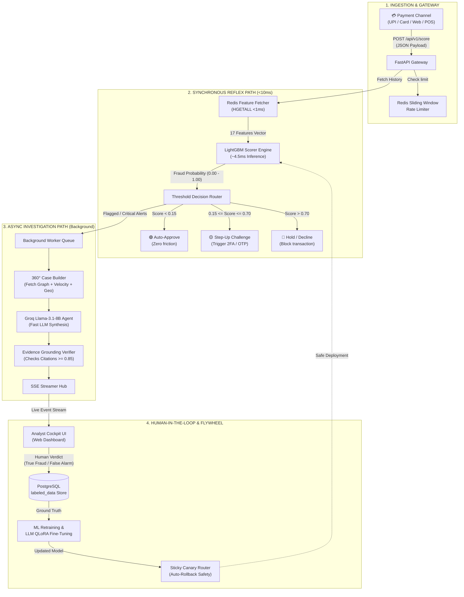
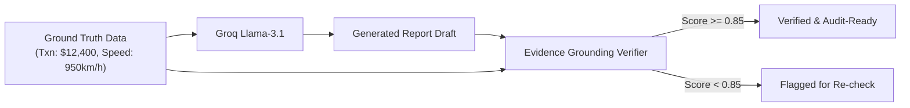

# 🧠 The Complete Mental Map of SentinelForge
> **A Beginner-to-Expert Architecture Guide to Real-Time Fraud Detection & Autonomous AI Investigations**

---

## 🧭 1. The Big Picture: What Problem Are We Solving?

Imagine this everyday scenario:
1. You are at an airport coffee shop and tap your credit card or scan a UPI QR code to pay **$4.50**.
2. Within **less than a quarter of a second** (before the terminal beeps), the bank must decide:
   - *Is this really you?*
   - *Or did a criminal in another continent steal your card credentials?*
3. If the bank takes more than **150 milliseconds**, your payment times out and the transaction fails.
4. If the bank falsely declines you, you get frustrated (**False Positive**).
5. If the bank lets a criminal drain $5,000, the bank loses money and violates regulations (**False Negative**).
6. To make matters harder, government watchdogs (like FinCEN or FIU) require banks to file legally binding, detailed **Suspicious Activity Reports (SAR)** explaining *exactly why* a transaction was flagged as fraudulent.

### ⚡ The Architectural Paradox
- **Real-Time Payment Rails** need decisions in **<10 milliseconds**.
- **Financial Crime Investigations** take humans **hours or days** to research, look up account history, calculate risk, and draft legal reports.

### 🛡️ The SentinelForge Solution: Dual-Path Architecture
SentinelForge splits this problem into two synchronized parallel paths:
- **Path 1 (The Reflex Arc - Synchronous):** A lightning-fast mathematical model ([LightGBM](https://lightgbm.readthedocs.io/)) evaluates 17 real-time behavioral features stored in an in-memory cache ([Redis](https://redis.io/)) and makes an approve/decline decision in **~4.5 milliseconds**.
- **Path 2 (The Detective Bureau - Asynchronous):** If a transaction is suspicious, a background AI agent powered by an LLM ([Groq Llama-3.1-8B](https://groq.com/)) gathers a 360° dossier (device history, travel speed, fraud ring graph) and writes a complete, hallucination-checked investigative report in seconds—without ever delaying the customer's checkout line.

---

## 🗺️ 2. High-Level Architecture Diagram

Here is how data flows from the moment a user initiates a transaction to the moment an analyst reviews the AI-generated dossier:



---

## 🔍 3. The 6 Core Pillars of SentinelForge (Explained Simply)

Let's break down each system component as if explaining it to a fellow software engineer new to financial machine learning.

---

### Pillar 1: FastAPI Gateway & Ingestion
- **Location:** `services/api/`
- **What it does:** The front door of the system. It receives transaction requests over HTTP REST endpoints.
- **Why it matters:**
  - **Tracing:** Every request is stamped with a unique `X-Request-ID` so it can be tracked through all logs and database tables.
  - **Sliding-Window Rate Limiting:** Prevents malicious bots from overwhelming the scoring engine by tracking transaction frequencies in Redis sorted sets.
  - **Sub-Millisecond Routing:** Uses Python's `asyncio` and `uvicorn` to process thousands of requests concurrently.

---

### Pillar 2: Real-Time Feature Store (The Memory)
- **Location:** `services/feature_engine/` and `shared/db/redis_client.py`
- **The Problem:** The ML model doesn't just need the current payment amount; it needs context:
  - *How many times has this card been used in the last 15 minutes?*
  - *Where was this person 30 minutes ago?*
  - *Is this device associated with 10 different accounts?*
- **The Solution:** Rather than running slow SQL queries against a disk-based database, SentinelForge precomputes features and stores them in **Redis (In-Memory)**:
  
```
+-------------------------------------------------------------------------+
|                        FEATURE CALCULATOR CATEGORIES                    |
+-----------------------------------+-------------------------------------+
| 1. Velocity Features              | How fast is the user spending?      |
|    (velocity_features.py)         | - swipe_count_5m, swipe_count_1h    |
|                                   | - amount_sum_1h, amount_velocity    |
+-----------------------------------+-------------------------------------+
| 2. Geo-Spatial Features           | Where is the transaction happening? |
|    (geo_features.py)              | - Haversine distance between swipes |
|                                   | - Implied speed in km/h             |
|                                   |   (e.g., >800 km/h = Impossible!)   |
+-----------------------------------+-------------------------------------+
| 3. Entity Graph Features          | Who is connected to whom?           |
|    (graph_features.py)            | - Shared IP addresses & device IDs  |
|                                   | - Degree centrality & fraud rings   |
+-----------------------------------+-------------------------------------+
```

---

### Pillar 3: Ultra-Fast LightGBM Scoring Engine
- **Location:** `services/scoring/scorer.py` and `ml/training/train_lightgbm.py`
- **What is LightGBM?** 
  - LightGBM is **not** a large language model. It is an ultra-fast **Gradient Boosted Decision Tree (GBDT)** library developed by Microsoft.
  - While an LLM might take 500ms to 2000ms to generate text, LightGBM evaluates structured tabular numbers (17 features) in **~4.5 milliseconds on standard CPUs**.
- **The Threshold Router (`threshold_router.py`):**
  - Outputs a probability score between `0.00` and `1.00`.
  - Maps scores into business actions using cost-sensitive matrices:
    - **Score < 0.15:** `APPROVE` (Legitimate customer, instant approval)
    - **0.15 ≤ Score ≤ 0.70:** `STEP_UP_2FA` (Unusual pattern, ask for SMS OTP or facial verification)
    - **Score > 0.70:** `HOLD / DECLINE` (High-confidence fraud, block transaction)

---

### Pillar 4: Autonomous AI Investigation Agent (The Detective)
- **Location:** `services/investigation/investigation_agent.py` & `case_builder.py`
- **The Problem:** When an alert is flagged, a bank compliance officer usually has to open 5 different tabs, check past transactions, cross-examine IP logs, and manually write a report.
- **The Solution:** An autonomous agent powered by **Groq Llama-3.1-8B**:
  1. **360° Context Builder:** Gathers transaction details, velocity history, geographical impossible-speed calculations, and graph links into a compact context bundle.
  2. **SAR Synthesis:** Prompts Llama-3.1 to generate an audit-ready Suspicious Activity Report with executive summary, timeline, and risk justification.
  3. **High-Speed Inference:** Powered by Groq's LPU (Language Processing Unit), this LLM synthesis finishes in under **1 to 2 seconds**.

---

### Pillar 5: Evidence Grounding Citation Verifier (Anti-Hallucination)
- **Location:** `services/investigation/evidence_grounding.py`
- **The Problem:** LLMs are prone to "hallucinations"—they might invent numbers, cite wrong amounts, or hallucinate non-existent IP addresses. In legal compliance, a hallucinated report is dangerous and illegal.
- **The Solution:** A deterministic verifier that:
  - Scans every fact and metric claimed in the AI narrative.
  - Matches each citation against the actual ground-truth context bundle.
  - Calculates a **Grounding Citation Score (0.0 to 1.0)**.
  - If the score is `< 0.85`, the report is rejected or flagged as unverified!



---

### Pillar 6: Continuous Learning & Safe Deployment
- **Location:** `services/scoring/canary_router.py`, `auto_rollback.py`, and `ml/monitoring/`
- **Sticky Canary Routing:** When deploying a new model version, we don't switch 100% of traffic at once. We hash the `user_id` so that e.g. 10% of users consistently see the candidate model (sticky session) while 90% see the baseline model.
- **Circuit Breaker & Auto-Rollback:** If the candidate model's latency exceeds 15ms or error rate rises above 0.5%, the system automatically trips a circuit breaker and rolls back to the stable baseline model within milliseconds.
- **Data Flywheel:** Human analysts click "Confirm Fraud" or "False Positive" on the dashboard. This label is saved to PostgreSQL `labeled_data` to automatically retrain future iterations of the ML model.

---

## 🗂️ 4. Codebase Navigation Map

Here is where the magic happens across the folders:

```
SentinelForge/
├── services/
│   ├── api/                       # REST API endpoints & middleware
│   │   ├── main.py                # FastAPI app root, CORS, lifecycle hooks
│   │   └── routers/               # Routes: /score, /investigate, /health
│   ├── feature_engine/            # Feature computation algorithms
│   │   ├── velocity_features.py   # Spending counts and sliding-window velocities
│   │   ├── geo_features.py        # Haversine distance & impossible travel speed
│   │   └── graph_features.py      # Device/IP network graph analysis
│   ├── scoring/                   # Model execution & rollout safety
│   │   ├── scorer.py              # LightGBM scoring engine
│   │   ├── threshold_router.py    # Multi-tier cost-sensitive decision logic
│   │   ├── canary_router.py       # Sticky Canary traffic splitter
│   │   └── auto_rollback.py       # Circuit breaker & latency health monitoring
│   ├── investigation/             # LLM autonomous detective system
│   │   ├── case_builder.py        # Gathers 360° context data bundle
│   │   ├── investigation_agent.py # Groq Llama-3.1 prompt executor
│   │   └── evidence_grounding.py  # Anti-hallucination fact citation checker
│   ├── dashboard/                 # Real-time monitoring frontend & stream
│   │   ├── sse_streamer.py        # Server-Sent Events (SSE) push channel
│   │   └── static/index.html      # Glassmorphic Analyst Cockpit Web UI
│   └── transaction_simulator/     # Synthetic payment generator
│       └── simulator.py           # Simulates normal and fraudulent payment streams
│
├── ml/
│   ├── training/                  # Offline model training
│   │   ├── train_lightgbm.py      # LightGBM training pipeline with Optuna
│   │   └── class_imbalance.py     # SMOTE & Focal Loss techniques for rare fraud
│   ├── fine_tuning/               # LLM domain adaptation
│   │   └── qlora_trainer.py       # 4-bit QLoRA fine-tuning for regulatory compliance
│   └── monitoring/                # Data drift monitoring
│       └── psi_monitor.py         # Population Stability Index (PSI) feature drift
│
├── shared/
│   ├── config/settings.py         # Pydantic environment configurations (.env)
│   ├── db/                        # Database connectors
│   │   ├── postgres.py            # Async PostgreSQL connection pool
│   │   └── redis_client.py        # In-memory Redis client (sliding windows)
│   └── models/                    # Pydantic schemas for transactions & alerts
│
└── docker-compose.yml             # Local Postgres & Redis containers
```

---

## 🔬 5. Step-by-Step Life of a Transaction

Let's follow a single suspicious transaction from beginning to end:

| Step | Action | Time Taken | Component |
| :--- | :--- | :--- | :--- |
| **1. Ingest** | User buys a luxury watch for $4,200 in London. Request arrives via `POST /api/v1/score`. | **0.5 ms** | `services/api/` |
| **2. Feature Fetch** | System asks Redis: *"Has this user transacted recently?"* Redis reveals: *"Yes, 15 minutes ago in New York!"* | **0.8 ms** | `services/feature_engine/` |
| **3. Geo Calculation** | System calculates distance: NY to London is ~5,500 km in 15 mins → Speed = **22,000 km/h (Physically Impossible)**. | **0.1 ms** | `geo_features.py` |
| **4. ML Scoring** | 17 features fed to LightGBM. Output: `fraud_probability = 0.94`. | **4.2 ms** | `scorer.py` |
| **5. Decision** | `0.94 > 0.70` Threshold triggers: Transaction **DECLINED / HELD**. Customer receives instant notification. | **0.2 ms** | `threshold_router.py` |
| **Total Sync Time** | **Customer receives authorization answer** | **~5.8 ms** | *(Well under 150ms limit)* |
| **6. Async Investigation** | Flagged transaction triggers background worker. Groq Llama-3.1-8B writes a legal SAR report. | **~1.2 sec** | `investigation_agent.py` |
| **7. Verification** | Grounding Verifier checks that $4,200, New York, and London timestamps are exact facts from data. | **15 ms** | `evidence_grounding.py` |
| **8. Real-Time Alert** | Dossier pops onto the analyst's dashboard in real-time via SSE. | **Instant** | `sse_streamer.py` + UI |

---

## 💻 6. Quick Reference: How to Run Everything

### 1. Start Infrastructure (PostgreSQL & Redis)
Ensure Docker Desktop is running, then execute:
```powershell
docker compose up -d postgres redis
```

### 2. Configure Environment (`.env`)
Make sure your `.env` contains:
```env
REDIS_HOST=localhost
REDIS_PORT=6379
POSTGRES_HOST=localhost
POSTGRES_PORT=5432
POSTGRES_DB=sentinelforge
POSTGRES_USER=sentinel
POSTGRES_PASSWORD=sentinel_secret
GROQ_API_KEY=your_free_groq_api_key_here
```
*(Get a free key in 30 seconds at [console.groq.com](https://console.groq.com/))*

### 3. Launch SentinelForge API & Dashboard
```powershell
uvicorn services.api.main:app --host 0.0.0.0 --port 8000 --reload
```
- **Analyst Cockpit UI:** Open `http://localhost:8000/dashboard`
- **Interactive Swagger Docs:** Open `http://localhost:8000/docs`

### 4. Run Transaction Simulator (Generate Live Traffic)
In a second terminal window:
```powershell
python -m services.transaction_simulator.simulator --rate 2.0 --fraud-ratio 0.15
```
Watch real-time transactions and fraud alerts stream live across your screen!

---

## 🎯 7. Summary Mental Model (Takeaway)

> **"LightGBM is the lightning-fast bouncer at the door checking IDs in 5 milliseconds. Redis is the bouncer's photographic memory. Groq Llama-3.1 is the private detective writing the court case in the back office. The Evidence Grounding Verifier is the judge making sure the detective told no lies."**
